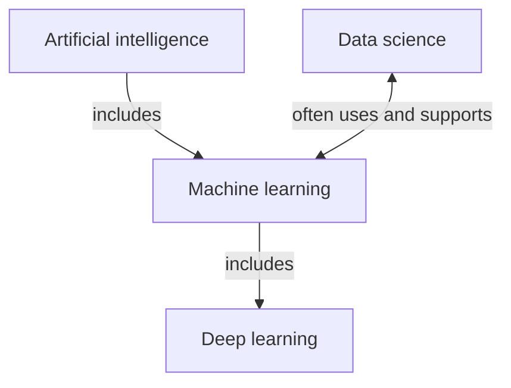

# Introduction to Machine Learning

## Challenge

Artificial intelligence is the broad goal of making machines perform tasks associated with intelligent behavior. Machine learning is one way to pursue that goal: instead of encoding every rule, an algorithm learns useful patterns from examples. Deep learning is a part of machine learning that uses multilayer neural networks. Data science is a broader practice for turning data into evidence and products; it can use ML, but it also includes collection, cleaning, visualization, statistics, and communication.

| Field | Suitable problems |
| --- | --- |
| Artificial intelligence | Planning a delivery route; controlling a rule-based game agent |
| Machine learning | Predicting house prices; detecting fraudulent transactions |
| Deep learning | Recognizing objects in images; transcribing speech |
| Data science | Measuring customer-retention trends; explaining results from a public-health survey |

The boundaries overlap. For example, an image classifier can be AI, ML, deep learning, and part of a data-science project at the same time; the labels describe different aspects of the work.

## Assignment — Skipped

The non-graded Python Learning Path and introductory videos are external training activities, so they are excluded under the approved scope. The local Python environment is validated by the executed Regression notebooks later in this portfolio.
