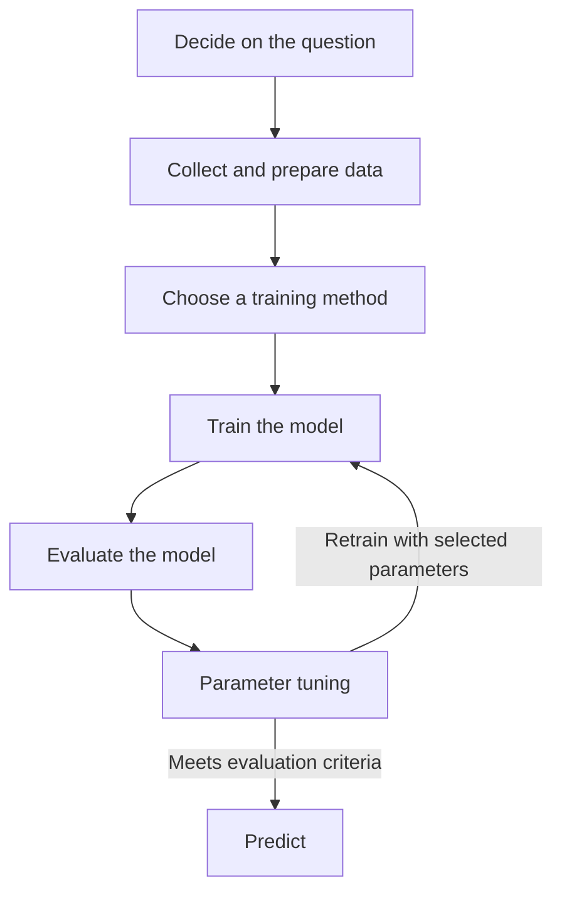

# Techniques of Machine Learning

## Challenge

The seven lesson stages form an iterative workflow:

1. **Decide on the question:** Define the target, intended users, and success criteria; check whether a simple rule would suffice.
2. **Collect and prepare data:** Document sources and representation, clean the data, and separate training, validation, and test examples. Fit preprocessing only on training data to prevent leakage.
3. **Choose a training method:** Match the problem to a suitable approach, such as supervised regression for a numeric target, and choose a simple baseline.
4. **Train the model:** Fit the selected method to training features and their targets.
5. **Evaluate the model:** Use validation data or cross-validation during development to assess errors, overfitting, and subgroup performance. Reserve the untouched test set for the final assessment after tuning.
6. **Parameter tuning:** Adjust hyperparameters using validation results and retrain. Revisit the data or method if the model still fails the agreed criteria.
7. **Predict:** Apply the selected model and its fitted preprocessing to new inputs. Monitor outcomes and return to earlier stages when performance changes.

## Personal reflection — Skipped

The questions about the learner's current position, expected difficulties, and strengths require personal reflection. They are left for the learner; no personal experience is invented.

## Assignment — Skipped

The data scientist interview requires external participation and is excluded under the approved scope. No interview, attributed testimony, or account of a professional's daily work is fabricated.
