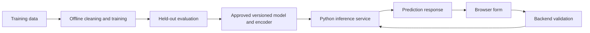

# Web App assignment — try a different model

## Completed locally

The [assignment](../../../3-Web-App/1-Web-App/assignment.md) asks for a web app using an earlier regression model, with inputs matching training. This app reuses the **Month → price per bushel** linear regression experiment from [the earlier notebook](../../2-Regression/3-Linear/notebook.ipynb).

- [train.py](train.py) repeats the same bushel-package cleaning, normalizes half-bushel and 1 1/9-bushel prices, uses the same 80/20 split with `random_state=42`, evaluates the model, and exports it locally.
- [app.py](app.py) loads that model once and handles the form submission.
- [templates/index.html](templates/index.html) asks for an integer month from 1 to 12 and displays the prediction in USD per bushel. Both browser and server validate the input. The server reads the named `month` field, so extra fields and form ordering cannot change the feature mapping.

The original lesson's seconds, latitude, longitude, country encoding, and classification labels do not belong in this regression form. The model receives a one-column DataFrame named `Month`, exactly as during training, and returns a numeric price.

## Run

From the repository root:

```bash
/opt/anaconda3/bin/python -m pip install -r homework-solutions/requirements.txt
/opt/anaconda3/bin/python homework-solutions/3-Web-App/1-Web-App/train.py
/opt/anaconda3/bin/python homework-solutions/3-Web-App/1-Web-App/app.py
```

Open <http://127.0.0.1:5000>. Stop the server with Ctrl+C. Substitute your environment's Python executable if needed. Training and model loading resolve paths relative to the scripts, so they also work from the assignment directory.

The generated `pumpkin-model.pkl` is ignored by Git and is recreated by the training command. Load only the artifact generated by this script: pickle files can execute code. Regenerate it when changing the Scikit-learn environment.

## Results and limitations

Verified on 2026-10-18: **415 cleaned rows**, **332 training rows**, **83 test rows**, test **R² −0.013** and **MAE 9.176 USD/bushel**. Export/reload predictions match. The model is fitted only on training rows; the held-out rows are used for evaluation.

The app demonstrates integration successfully, but month alone has poor predictive power. A negative test R² means it does worse than predicting the test-set mean. The page states this limitation, and the output is a historical learning example rather than a current market quote. The numeric month also treats December and January as far apart, and months outside the observed selling season extrapolate beyond training coverage.

## Verification

```bash
/opt/anaconda3/bin/python -m unittest discover -s homework-solutions/tests -v
```

The app test rebuilds the model, renders the home page, checks valid month predictions, rejects missing, nonnumeric, nonfinite, fractional, and out-of-range input, and verifies that an unrelated form field cannot alter a prediction. Training checks the earlier MAE and verifies the pickle round trip.

Browser checks completed on **2026-10-19 Asia/Singapore** in a separate headless Chrome for Testing profile. Month 10 displays **USD 27.81 per bushel**. Browser validation rejects empty, fractional, and out-of-range months; bypassing it still returns HTTP 400 with an accessible error. Desktop and 390px mobile screenshots were inspected, with no mobile horizontal overflow. The verification used port 5010 because the system's Control Center occupied 5000. See the [browser report and screenshots](../../verification/browser-checks.md).

## Deployment — skipped

Cloud deployment remains an approved portfolio exclusion. The rubric's exemplary tier explicitly includes cloud deployment, so this is a completed **local implementation**, not a claim to have met that deployment criterion.

## UFO exercise

The [executed notebook](notebook.ipynb) cleans the source UFO reports, trains a scaled logistic regression model, reports held-out accuracy, macro F1, a majority-class baseline, and a confusion matrix, then exports and reloads the pipeline and label encoder together. Numeric data is coerced before filtering; missing values, unknown countries, nonfinite values, and invalid coordinates are excluded. The encoder and scaler are fitted only on training data.

The notebook and [UFO app](ufo_app.py) share the same cleaning and training functions so the app cannot silently use a different feature order. Run the notebook from this directory. The UFO app can be launched from the repository root:

The executed run retained **25,863 of 80,332 reports**, with **20,690 training** and **5,173 test** rows. Test accuracy is **0.9615**, compared with a **0.9130** majority-class baseline; macro F1 is **0.6878**. Canadian recall is only **0.36**, and none of the **8 German test reports** is classified correctly. These results show why accuracy alone is misleading. The lesson's sample `[50, 44, -12]` predicts `de` in this fitted model, rather than the lesson's illustrative UK result: standardization and the stratified split change the fit, and an ocean coordinate is not a reliable country-classification example.

Launch command:

```bash
/opt/anaconda3/bin/python homework-solutions/3-Web-App/1-Web-App/ufo_app.py
```

Open <http://127.0.0.1:5001>, press **Train local model**, and submit the duration and coordinates. This is separate from the pumpkin assignment on port 5000.

## Challenge — train inside Flask

The UFO app implements `POST /train`. It trains from the repository dataset, evaluates on held-out rows, and installs the resulting model and encoder in the running application's memory. `POST /predict` returns a helpful 503 response before training. It rejects missing, nonfinite, and out-of-range features with HTTP 400. Training does not run through GET, and no uploaded data or arbitrary file paths are accepted.

**Pros:** one runnable application demonstrates the entire learning cycle; users can explicitly rebuild the model; training and prediction share feature preparation; no separate model-transfer step is required for this experiment.

**Cons:** synchronous training occupies a request worker, adds latency, and repeats computation. Each process has its own model, and restarting discards it. The demo has no authenticated training administration or model version history, so it is intended for local use. A production design should run an authenticated training job separately, evaluate a candidate model before promotion, and load a versioned artifact consistently across inference workers. The app replaces the active model only after training succeeds.

## Review — architecture options

- **Python app with an in-process model:** Flask handles HTML or JSON requests and calls Scikit-learn directly. This is the simplest fit for the existing Python model.
- **Python inference service with a JavaScript frontend:** the browser sends validated feature values as JSON; the service repeats validation, runs inference, and returns a prediction. Training is a separate workflow.
- **JavaScript inference in the browser:** a compatible converted model can run through a browser runtime such as TensorFlow.js or ONNX Runtime Web. This can reduce server requests, but requires checking operator compatibility, download size, and preprocessing parity. Model weights are delivered to clients.
- **Hosted model endpoint:** a backend calls a remotely hosted inference service. This supports independent scaling and model releases but adds network latency, service costs, and failure handling. Service credentials stay on the backend.

For this assignment, keep inference in Flask. For a shared deployed service, separate training from prediction as follows:



The browser supplies only the expected features. The backend preserves their names, order, units, and ranges. A remotely hosted version replaces the in-process prediction call with an authenticated service call; it does not expose credentials to the browser. This architecture is a design answer, not a cloud deployment claim.

## Quizzes

Both pre- and post-lecture quizzes are answered in [quiz-answers.md](quiz-answers.md).
